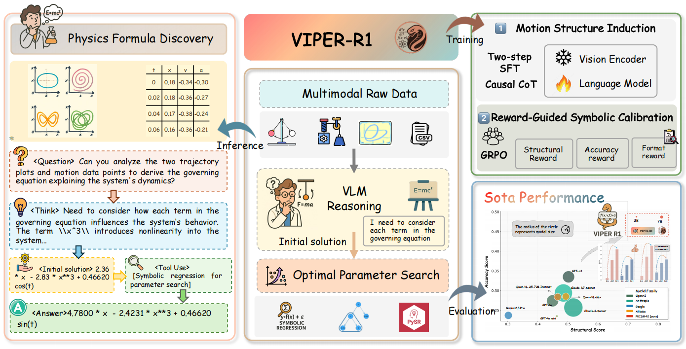

# VIPER-R1: Mimicking the Physicist's Eye

<div align="center">

### A VLM-centric Approach for Physics Formula Discovery

[](https://arxiv.org/abs/2508.17380)
[](https://jiaaqiliu.github.io/VIPER-R1/)
[](https://opensource.org/licenses/MIT)

[**📄 Paper**](https://arxiv.org/abs/2508.17380) | [**🌐 Project Page**](https://jiaaqiliu.github.io/VIPER-R1/) | [**🤗 Model**](https://huggingface.co/JiaaqiLiu/VIPER-R1-RL) | [**💻 Code**](https://github.com/Jiaaqiliu/VIPER-R1)

</div>

## 📖 Abstract

Automated discovery of physical laws from observational data is a grand challenge in AI. Current methods, relying on symbolic regression or LLMs, are limited to uni-modal data and overlook the rich, visual phenomenological representations of motion that are indispensable to physicists. This "sensory deprivation" severely weakens their ability to interpret the inherent spatio-temporal patterns within dynamic phenomena.

To address this gap, we propose VIPER-R1, a multimodal model that performs Visual Induction for Physics-based Equation Reasoning to discover fundamental symbolic formulas. It methodically integrates visual perception, trajectory data, and symbolic reasoning to simulate the scientific discovery process.

The model is trained via a curriculum of Motion Structure Induction (MSI), using supervised fine-tuning to interpret kinematic phase portraits and construct hypotheses guided by a Causal Chain of Thought (C-CoT), followed by Reward-Guided Symbolic Calibration (RGSC) to purify the formula's structure with reinforcement learning. During inference, the trained VIPER acts as an agent: it first posits a high-confidence symbolic ansatz, then proactively invokes an external symbolic regression tool to perform Symbolic Residual Realignment (SR²). This final step, analogous to a physicist's perturbation analysis, reconciles the theoretical model with empirical data.

To support this research, we introduce PhysSymbol, a new 5,000-instance multimodal corpus. Experiments show that VIPER-R1 consistently outperforms state-of-the-art VLM baselines in accuracy and interpretability, enabling more precise discovery of physical laws.


## 🔥 Highlights

- **🎯 Novel Approach**: First VLM-based framework for physics formula discovery that integrates visual perception with symbolic reasoning
- **🏆 SOTA Performance**: 56.7% improvement in structural score and 45.4% improvement in accuracy over best baselines
- **🧠 Multi-Stage Training**: Motion Structure Induction (MSI) + Reward-Guided Symbolic Calibration (RGSC) pipeline
- **🤖 Agentic Design**: Symbolic Residual Realignment (SR²) with external tool integration
- **📊 New Benchmark**: PhysSymbol dataset with 5,000 multimodal instances

## 🚀 Key Results

| Metric | VIPER-R1 | Best Baseline | Improvement |
|--------|----------|---------------|-------------|
| Structural Score | **0.812** | 0.518 | **+56.7%** |
| Accuracy Score | **0.487** | 0.335 | **+45.4%** |
| Post-SR² MSE | **0.032** | 0.091 | **3× lower** |

## 🏗️ Framework Overview

<div align="center">

</div>

VIPER-R1 consists of three main stages:

1. **Motion Structure Induction (MSI)**: Two-step supervised fine-tuning for visual interpretation and hypothesis construction
2. **Reward-Guided Symbolic Calibration (RGSC)**: Reinforcement learning for formula structure refinement
3. **Symbolic Residual Realignment (SR²)**: Agentic tool use for empirical-theoretical reconciliation


## 📊 PhysSymbol Dataset

The PhysSymbol dataset contains 5,000 multimodal instances for physics formula discovery:

- **Visual Data**: Kinematic phase portraits (velocity vs. position)
- **Trajectory Data**: Time series of position, velocity, and acceleration
- **Symbolic Ground Truth**: Mathematical equations governing the dynamics
- **Reasoning Chains**: Causal Chain of Thought (C-CoT) explanations

### Dataset Statistics
- **Physics Terms**: 11 different types (harmonic, damping, driving forces, etc.)
- **Complexity Levels**: From simple harmonic motion to complex multi-scale dynamics
- **Visualization Types**: Phase space and temporal trajectory plots

## 🏆 Experiments

### Main Results
VIPER-R1 demonstrates significant improvements over state-of-the-art VLMs:

- **Claude-4-Sonnet**: 0.518 → **0.812** structural score (+56.7%)
- **o3**: 0.335 → **0.487** accuracy score (+45.4%)
- **Final MSE**: 3× reduction in prediction error after SR²

### Ablation Studies
- MSI alone: +475% improvement over base model
- MSI + RGSC: +746% total improvement
- SR² refinement: Additional 3× error reduction

## 📄 Citation

If you find our work useful, please consider citing:

```bibtex
@article{liu2025VIPERr1,
  title={Mimicking the Physicist's Eye: A VLM-centric Approach for Physics Formula Discovery},
  author={Liu, Jiaqi and Lai, Songning and Li, Pengze and Yu, Di and Zhou, Wenjie and Zhou, Yiyang and Xia, Peng and Wang, Zijun and Chen, Xi and Tang, Shixiang and Bai, Lei and Ouyang, Wanli and Ding, Mingyu and Yao, Huaxiu and Wang, Aoran},
  journal={arXiv preprint arXiv:2508.17380},
  year={2025}
}
```
